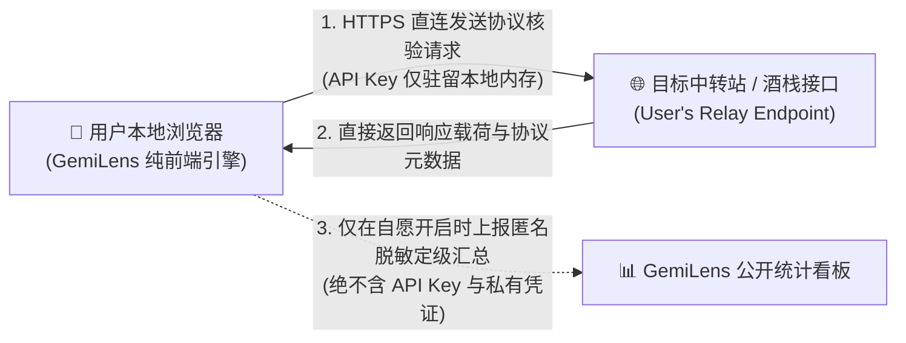

# 哈基米棱镜 · GemiLens

**面向长文本创作与角色扮演场景的 Google Gemini 中转渠道协议级验真棱镜**  
*Client-Side Protocol-Level Lineage & Anti-Dilution Verifier for Google Gemini Relays*

  <a href="https://gemilens.pages.dev/"><strong>🚀 立即体验在线检测台</strong></a> ·
  <a href="https://gemilens.pages.dev/guide"><strong>📚 九大渠道血统防坑指南</strong></a> ·
  <a href="#为什么写文与-rp-需要专属协议级验真"><strong>💡 设计理念</strong></a> ·
  <a href="#sss--f-七档定级体系"><strong>🏆 定级标准</strong></a>

---

## 🌐 Overview (English Summary)

**GemiLens (哈基米棱镜)** is a privacy-first, 100% client-side verification workbench built specifically to audit third-party **Google Gemini API relays** for creative writers, **SillyTavern** roleplayers, and **Chatbox** power users.

Unlike conventional developer ping scripts or `Tool Calling` benchmarks, GemiLens inspects orthogonal protocol-level signals — including **official native tokenizer span fingerprints**, **decoder control instruction verification**, **out-of-bounds protocol boundary responses**, **deep reasoning anchors**, and **multi-packet concurrent consistency sampling** — to expose downgraded model substitution, round-robin mixed pools ("阴阳混池"), `HTTP 200` empty-body billing traps, and injected system prompts. All test requests fire **directly from your browser** to your target endpoint with **zero server-side API key retention**.

- **Live Web App**: [https://gemilens.pages.dev/](https://gemilens.pages.dev/)
- **Static Lineage & FAQ Guide**: [https://gemilens.pages.dev/guide](https://gemilens.pages.dev/guide)

---

## 🎯 核心痛点：第三方 Gemini 中转生态的“四大暗礁”

在小说连载、SillyTavern 酒馆角色扮演与深度对话场景中，用户采购中转站或酒栈额度时极易遭遇以下隐蔽问题：

1. **小模型顶包与阉割降智**：网关通过一行隐藏系统指令让低成本轻量模型或异构开源模型自称旗舰 Pro，或暗中压低思考预算，单靠询问“你是谁”完全无法察觉。
2. **按包轮询“阴阳混池”**：前两次简单测试路由至正牌官方源，一旦进入万字世界书高频创作便暗切至廉价逆向池，导致创作质感忽高忽低。
3. **虚假血统宣传**：将成本极低的**个人网页官逆**、**AI Studio 工作台逆向 (as逆)** 或 **AntiGravity 反重力（IDE 代码通道）**包装成高价“过审企白真 Vertex”售卖，导致写文频繁截断、充满客服说教味。
4. **HTTP 200 空回吞字与假分词计费**：逆向转换壳在上游触发风控或审查断流时仍伪造返回 `HTTP 200` 空消息并照常扣费；或因拿不到官方回传用量而用异构分词器虚增账单消耗。

---

## 💡 为什么写文与 RP 需要专属协议级验真？

市面上常见的程序员向 API 检测工具通常聚焦于代码生成、JSON Schema 或 `Function Calling` 连通性，难以覆盖文学创作与酒馆用户的真实痛点：

| 对比维度 | 传统开发者测活 / 跑分工具 | 哈基米棱镜 GemiLens |
| :--- | :--- | :--- |
| **核心关注点** | 接口能否调通、工具调用格式是否正确 | **底层真实血统、文风零预设纯净度、防截断透传与混池排查** |
| **反作弊能力** | 常依赖公开固定题面，易被不良网关正则匹配精准绕过 | **正交协议层指纹 + 分词跨度 + 解码控制 + 并发一致性交叉核验** |
| **隐式预设污染识别** | 不敏感（写代码受前置人设影响小） | **高敏识别 IDE 通道/网页官逆自带的系统指令与说教味干扰** |
| **计费与吞字排障** | 仅看 HTTP 状态码是否为 200 | **穿透核验 `HTTP 200` 空载荷吞额度及非原生假分词虚高计费** |
| **阴阳混池检出率** | 单次串行请求极易漏检 | **多包并发抽样一致性校验，直接捕捉轮询分叉与品质抖动** |

---

## 🔒 隐私安全架构：零服务端留存

很多用户担心：“把自己的中转站 API Key 填进在线验真网站，会不会被后台记录甚至盗刷额度？”

哈基米棱镜从架构底层彻底消除了这一隐患——采用 **纯浏览器本地直连（Client-Side Direct Fetch）** 设计：

- **零密钥上传**：你的 `API Key` 与私有接口凭证绝不经过哈基米棱镜后端服务器，无反向代理截留、无服务端日志。
- **代码逻辑透明可审计**：打开浏览器开发者工具（`F12 -> Network`），即可亲眼验证所有模型测试请求均直接发往你所填写的目标域名。

---

## 🧬 Google Gemini 九大渠道血统图谱

哈基米棱镜结合协议边界响应、原生元数据完整性与分词特征，协助用户客观辨识市面九大主流渠道形态（完整解读详见 [渠道百科指南](https://gemilens.pages.dev/guide)）：

| 渠道血统 | 底层本质 | 零预设与写文防截断表现 | 典型评级区间 |
| :--- | :--- | :--- | :---: |
| **过审企白真 Vertex** | Google Cloud 正式过审企业白名单商业源 | 安全阈值豁免权限最高，保留原生思考签名，高并发长文防截断天花板 | `SSS` |
| **一手纯净真 Vertex / 二道真 Vertex** | 标准 Google Cloud 项目直连或经证实源头为真 Vertex | 支持官方原生无过滤档、计费精准、零预设纯净无污染 | `S` |
| **一手 / 二道 Google AI Studio (AIS)** | 官方 AI Studio 开发者 API 直连或标准转接 | 语感鲜活自然、不抢酒馆预设（共享池需防高峰期触发静默降级） | `A` / `B` |
| **二道正规 API 纯净源** | 已排除逆向与反重力的正规 Vertex / AIS 转接源 | 零塞词无过滤、分词计量真实可靠，日常写小说主力闭眼冲 | `A` |
| **二道转接池 / 拼车号池 / 改装转换壳** | 源头隐藏转接池 `(VT/AIS/反重力)`、账号池拼车或参数过滤壳 | 已排除网页官逆与企业助手，因无法排除反重力或剥离了原生账单封顶 B 级 | `B` / `C` |
| **Gemini Enterprise (EP / E)** | Google 企业办公助手通道（GCP 付费版 EP / 席位版 E） | 智商正常，写清水正剧与大世界书很香；无法手动关闭内置安全护栏 | `B`（粗估分词 `C`） |
| **AI Studio 工作台逆向 (as逆)** | 逆向封装自 AI Studio 网页工作台接口 | 真模型分词且无过滤可用，但剥离了原生思考签名与越界参数校验 | `B` |
| **AntiGravity 反重力** | 桥接 Google AntiGravity 内部编程通道 | 审查较宽松的高性价比渠道；通常带有桥接层前置指令，建议配完整酒馆预设 | `B` |
| **个人网页官逆 (gemini.google.com)** | 逆向抓取自消费者个人免费网页端 | 无 API 参数控制、本地估算计费且外置审查全网最严，高冲突易拒写 | `C` |

---

## 🏆 SSS ~ F 七档定级体系

- **`SSS` 企白真金 · 写文天花板**：经硬协议验明的过审企业白名单真 Vertex 通道，支持最高级别安全豁免且保留原生加密思考签名，零塞词无瑕疵。
- **`S` 纯血真 VT · 旗舰顶配**：一手纯净真 Vertex（原生无过滤档）、真 Vertex + AIS 原生混池，或零瑕疵二道转接真 Vertex，全题材通吃。
- **`A` 正规 API · 创作主力**：一手健康 Google AI Studio 原生直连、二道转接 AI Studio 或零塞词二道正规 API 纯净源，底座干净不抢酒馆预设。
- **`B` 高性价比实用之选**：含 `EP / E` 企业助手（清水与大世界书优选）、反重力 / 二道拼车号池 / `as逆` 高性价比无过滤渠道、二道转接池与改装转换壳。
- **`C` 模型正常 · 外部受限**：底层旗舰模型未降级，但受外部明显限制（如个人免费网页官逆外置严审死锁、本地粗估假分词壳，或焊死超长前置预设）。
- **`D` 静默降级 · 池子失稳**：未虚标 Vertex 的常规/共享号池触发风控静默路由至轻量模型或疑似混入低配节点，建议暂停使用并提醒站长清号。
- **`F` 一票否决红牌避雷**：假冒 Vertex 降级顶包、实锤异厂或低阶小模型掉包、按包轮询真假混池掺水，或触发拦截返回 `HTTP 200` 空回吞字白扣费。

---

## 🔗 快速入口

- **⚡ 在线免费验真工作台**：[https://gemilens.pages.dev/](https://gemilens.pages.dev/)
- **📖 渠道血统图谱与 8 大实战问答**：[https://gemilens.pages.dev/guide](https://gemilens.pages.dev/guide)
- **🤖 AI 搜索引擎结构化知识库**：[`llms.txt`](https://gemilens.pages.dev/llms.txt) | [`llms-full.txt`](https://gemilens.pages.dev/llms-full.txt)

---

  Built with clarity & integrity for the creative writing & roleplay community · <b>哈基米棱镜 GemiLens</b>

